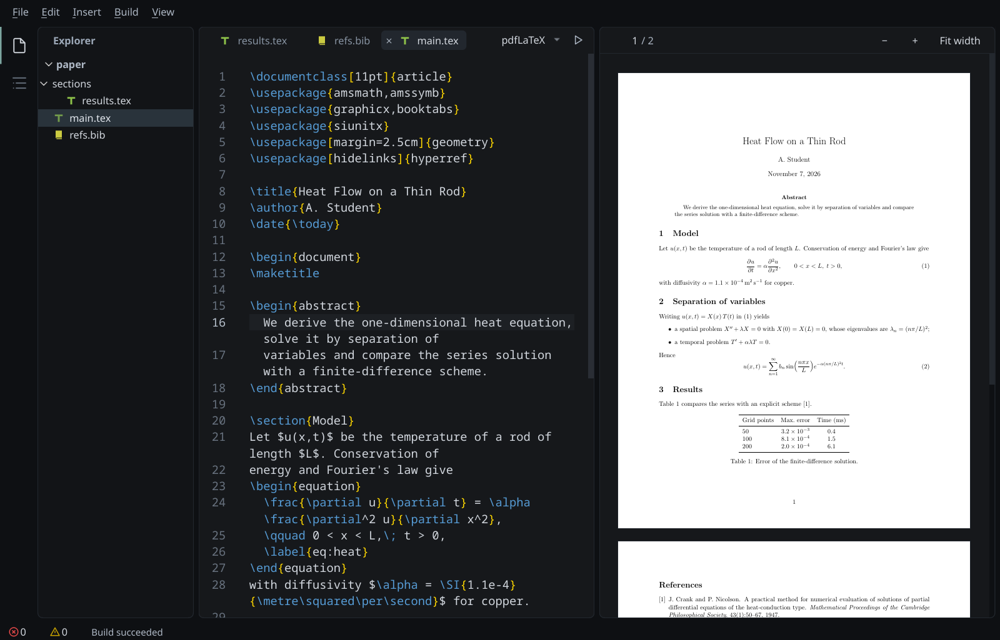

# Folitex

[](https://github.com/aquistusfami/Folitex/actions/workflows/ci.yml)

A lean, native LaTeX editor with a built-in PDF viewer, written in C++20 with
Qt 6 Widgets and Poppler. It aims to start fast, stay light on memory, render PDFs
sharply at any display scale and scroll smoothly — while covering the everyday
LaTeX workflow: edit, build, preview, jump between source and PDF.



> Folitex was previously developed as **TeXLite**. Its behaviour was informed by
> studying TeXstudio and VS Code; it contains no code from either project and is
> not affiliated with them.

## Features

**Editor**
- Tabs, UTF-8 sources, LaTeX syntax highlighting, line numbers, current-line
  highlight, bracket matching, auto-closing `{}` `[]` `()`, indentation kept on Enter.
- Context-aware completion (Ctrl+Space, or automatically while typing):
  ~300 LaTeX/amsmath commands with snippet placeholders (Tab jumps to the next one),
  environments with automatic `\end{…}`, `\ref` labels and `\cite` keys from your
  document, your own `\newcommand`s, package/class names from the installed TeX Live, and
  the commands of the packages you load (curated for ~45 common packages, read from the
  `.sty` for the rest).
- Word wrap (Alt+Z or right-click → Word Wrap); wrapped lines stay aligned with their
  line's indentation.
- VS Code-style find and replace over the editor (Ctrl+F, Ctrl+H): match case, whole word,
  match counter, Replace All as one undo step.
- Tab / Shift+Tab indent and outdent the selected lines; TeXstudio's insert shortcuts
  (`\textbf` Ctrl+B, `\emph` Ctrl+Shift+E, `\frac` Alt+Shift+F, …) plus `\underline` Ctrl+U.
- Files edited by another program — another editor or an AI coding agent — reload
  silently while the tab has no unsaved edits; the cursor stays put and Ctrl+Z undoes
  the external change. Unsaved edits are never overwritten.
- Safe saving: atomic writes, BOM / NBSP / CRLF preserved, invalid UTF-8 refused.

**Build and preview**
- One-key asynchronous builds through `latexmk` with pdfLaTeX, LuaLaTeX or XeLaTeX;
  `% !TeX root = …` for multi-file projects; output goes to `.folitex-build/`.
- Two-way SyncTeX: F7 jumps from the source to the PDF, Ctrl+click in the PDF jumps back.
- Problems panel after each build: errors with file and line, LaTeX and package warnings,
  over/underfull boxes. Click one (or F8 / Shift+F8) to jump there; the lines get red or
  yellow squiggles with the message on hover, and the status bar counts them.
- PDF viewer: continuous pages, text search (Ctrl+F in the PDF), select and copy text,
  clickable links, zoom, page jump, automatic reload after each build, right-click menu
  with Jump to Source.
- Background rendering at the display's native pixel density with a bounded image
  cache; image-heavy pages render in a single Poppler call (≈7× faster than small tiles).

**Workspace and interface**
- Open a folder as a workspace (Ctrl+K Ctrl+O) to browse TeX/BibTeX/PDF files, with
  file-type icons and a collapsible root folder.
- Outline of sections, labels, included files and TODOs; click to jump.
- Dark interface modelled on VS Code: rounded panels, flat tabs that scroll sideways and
  name the folder when two files share a name, the build log (Ctrl+J) under the editor.

## Installing on Linux

Folitex needs **Qt 6.5 or newer**, so it installs on Arch Linux and its derivatives
(Manjaro, EndeavourOS), Debian 13 and Ubuntu 25.04 or newer. Ubuntu 24.04 LTS and
Debian 12 ship Qt 6.4 and cannot build it. The steps below were run on clean systems:
Arch Linux and Debian 13 end to end (install, build, tests, launch), Ubuntu 25.04 up to
a successful build.

### 1. Install the dependencies

Arch Linux, Manjaro, EndeavourOS:

```bash
sudo pacman -S --needed base-devel git cmake qt6-base qt6-svg poppler-qt6 \
    texlive-bin texlive-binextra texlive-latexextra texlive-langother
```

Debian 13, Ubuntu 25.04 and newer:

```bash
sudo apt install build-essential git cmake pkg-config qt6-base-dev qt6-svg-plugins \
    libpoppler-qt6-dev latexmk texlive-latex-extra texlive-lang-other
```

The `texlive-…` packages and `latexmk` are what compile your documents. The
`langother` / `lang-other` package adds Vietnamese and other languages; skip it if you
only write in English. A TeX distribution you already have works too, as long as
`latexmk`, `synctex` and `kpsewhich` are on your `PATH`.

### 2. Download, build and install

```bash
git clone https://github.com/aquistusfami/Folitex.git
cd Folitex
cmake -S . -B build -DCMAKE_BUILD_TYPE=Release
cmake --build build --parallel
cmake --install build --prefix ~/.local
```

No root access is needed for this step. Folitex now appears in your application
launcher, and `folitex paper.tex` opens a file from a terminal. If the shell says
`folitex: command not found`, add `~/.local/bin` to your `PATH`.

Optionally, check the build with `ctest --test-dir build --output-on-failure`
(it compiles small documents, so it needs the TeX packages above).

### Updating

```bash
cd Folitex
git pull
cmake --build build --parallel
cmake --install build --prefix ~/.local
```

### Uninstalling

```bash
rm ~/.local/bin/folitex ~/.local/share/applications/folitex.desktop \
   ~/.local/share/icons/hicolor/scalable/apps/folitex.svg
rm -r ~/.config/Folitex   # optional: settings
```

Build output next to your documents lives in `.folitex-build/` folders, which you can
delete at any time.

### Troubleshooting

| Message or symptom | Fix |
|---|---|
| `Could not find a configuration file for package "Qt6" that is compatible with requested version "6.5"` | Your distribution's Qt is too old (Ubuntu 24.04, Debian 12). Use a newer release. |
| `Could NOT find PkgConfig` | Install `base-devel` (Arch) or `pkg-config` (Debian/Ubuntu). |
| `CMAKE_CXX_COMPILER not set` or `CMAKE_MAKE_PROGRAM` not found | Install `base-devel` (Arch) or `build-essential` (Debian/Ubuntu). |
| `No package 'poppler-qt6' found` | Install `poppler-qt6` (Arch) or `libpoppler-qt6-dev` (Debian/Ubuntu). |
| Icons in the side bar or tabs are blank | Install `qt6-svg` (Arch) or `qt6-svg-plugins` (Debian/Ubuntu). |
| Building a document fails with `Encoding scheme 'T5' unknown` or `Unicode character … not set up` | Install the language package: `texlive-langother` / `texlive-lang-other`. |
| F5 shows `Cannot start latexmk` | Install `texlive-binextra` (Arch) or `latexmk` (Debian/Ubuntu). |
| Folitex does not appear in the launcher | Log out and back in, or run `update-desktop-database ~/.local/share/applications`. |

## Installing on Windows (experimental, untested)

Folitex has not been built on Windows yet. The code avoids Linux-only calls outside
`#ifdef Q_OS_UNIX`, so a build is expected to work with [MSYS2](https://www.msys2.org/)
(UCRT64 shell):

```bash
pacman -S --needed mingw-w64-ucrt-x86_64-{gcc,cmake,ninja,qt6-base,qt6-svg,poppler-qt6}
cmake -S . -B build -G Ninja -DCMAKE_BUILD_TYPE=Release -DBUILD_TESTING=OFF
cmake --build build
```

Install [TeX Live for Windows](https://tug.org/texlive/windows.html), which includes
Perl, `latexmk`, `synctex` and the `ls-R` database. MiKTeX also works for building, but
needs a separate Perl (e.g. Strawberry Perl) for `latexmk` and gives no package-name
completion. Known differences on Windows:

- Stopping a build ends `latexmk` but may leave its `pdflatex` child running.
- There is no installer yet; run `build/folitex.exe` from the MSYS2 shell, or copy the
  Qt and Poppler DLLs next to it (`windeployqt`).

Reports of Windows builds — working or not — are welcome as issues.

## Using Folitex

Open a `.tex` file, press **F5** to build, and the PDF appears on the right. Settings
(workspace folder, word wrap, menu bar) are stored in `~/.config/Folitex/`.

Keyboard shortcuts follow TeXstudio where TeXstudio documents them.

| Key | Action |
|---|---|
| F5 / F6 | Build, or stop a running build |
| F7 | Show the cursor position in the PDF |
| F8 / Shift+F8 | Next / previous build problem |
| Ctrl+click in the PDF | Jump to the matching source line |
| Ctrl+Space | Complete command, environment, package, `\ref` or `\cite` |
| Tab / Ctrl+Right / Ctrl+Left | Next / next / previous snippet placeholder |
| Ctrl+B / Ctrl+I / Ctrl+U | `\textbf{}` / `\textit{}` / `\underline{}` (wrap the selection) |
| Ctrl+Shift+E / T / C / A | `\emph{}` / `\texttt{}` / `\textsc{}` / `\textsf{}` |
| Ctrl+Enter | New line `\\` |
| Ctrl+Shift+M / Alt+Shift+M / Ctrl+Shift+N | Inline math `$…$` / display math `\[…\]` / `equation` |
| Ctrl+Shift+D / Ctrl+Shift+U | Subscript `_{}` / superscript `^{}` |
| Alt+Shift+F / Ctrl+Shift+F / Ctrl+Shift+Q | `\frac{}{}` / `\dfrac{}{}` / `\sqrt{}` |
| Ctrl+Shift+L / Ctrl+Shift+R | `\left` / `\right` |
| Ctrl+Shift+I / Ctrl+E | `\item` / insert an environment |
| Alt+Return | Close the last open environment or brace |
| Tab / Shift+Tab | Indent / outdent the selected lines |
| Ctrl+/ | Toggle comment |
| Alt+Z | Toggle word wrap |
| Ctrl+F / F3 / Shift+F3 / Ctrl+G | Find (in the PDF when it has focus) / next / previous / go to line |
| Ctrl+H or Ctrl+R | Replace, Replace All in the current file |
| Ctrl+N / Ctrl+O / Ctrl+S / Ctrl+Shift+S / Ctrl+W | New / open / save / save as / close |
| Ctrl+K Ctrl+O | Open a workspace folder |
| Ctrl+PgDown / Ctrl+PgUp | Next / previous tab |
| Ctrl+= / Ctrl+- / Ctrl+0 | Zoom the PDF in / out / fit width |
| Ctrl+\ / Ctrl+J / Ctrl+Shift+O | Toggle PDF / Problems and Output panel / side bar |
| View → Menu Bar, then Alt | Hide the menu bar; a lone Alt shows it until an item is used |

In the PDF, drag to select text, double-click to select a word, Ctrl+C to copy and
click links to follow them. Right-click for Jump to Source, Copy, zoom and Open in
External Viewer.

## Status and limitations

Folitex is young (0.5) and deliberately smaller than TeXstudio. Known gaps:

- No spell or grammar checking, no full LaTeX parser, no session restore.
- The engine comes from the combo box; `% !TeX program` is not read yet.
- The outline covers the current file only; `\cite` completion reads `.bib` files
  next to open sources.
- PDF text selection stays within one page.
- Very large sources (tens of thousands of lines) use noticeably more memory, because
  the editor keeps pixel-smooth scrolling (Qt `QTextEdit`).
- Developed on Linux (Arch, Wayland); the automated tests run offscreen at 100 %,
  125 % and 200 % scale. Windows and macOS are untested (see Installing).

## Documentation

- [Architecture](docs/ARCHITECTURE.md) — how the editor, renderer and build runner fit together.
- [Changelog](CHANGELOG.md).
- [Research and measurements](docs/REA-ANALYSIS.md), [benchmark report](docs/BENCHMARK.md)
  and [validation log](docs/VALIDATION.md) from the prototype phase, plus later
  measurements under [`research/`](research/). These records keep the former name TeXLite.

## Contributing

Issues and pull requests are welcome. Please run the test suite before submitting —
`ctest --test-dir build --output-on-failure`, and for rendering or layout changes also
`QT_QPA_PLATFORM=offscreen QT_SCALE_FACTOR=1.25 ./build/folitex_tests` and scale `2`.
Code style: four-space indentation, braces on their own line, Qt naming. Rendering
stays off the UI thread and image caches stay bounded. See [AGENTS.md](AGENTS.md) for
the full guidelines.

CI builds and tests every push and pull request on Debian 13 and Arch Linux. To
release, set the version in `CMakeLists.txt` and `src/main.cpp`, add a matching
`## X.Y.Z — date` section to `CHANGELOG.md`, then push an annotated tag `vX.Y.Z`; the
release workflow reruns CI and publishes a GitHub release with that changelog section.

## License

GPL-3.0-only. See [LICENSE](LICENSE).
